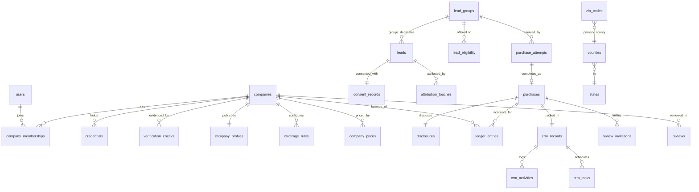

# Data Model

**Status:** Logical model for Phase 2 sign-off. Tables marked **(built)** already exist in `db/migrations/001_marketplace_core.sql` with passing tests. The others are specified here for Phase 4–7 migrations.
**Conventions:** UUID primary keys; `timestamptz` in UTC; money in **integer cents**; rates in **basis points**; ZIP codes and FIPS codes as **text**; append-only tables for evidence, ledger and audit; soft state changes through status enums with history tables.
**Last updated:** 2026-10-27

---

## 1. Entity overview

## 2. Identity, companies and permissions

| Table | Key fields | Notes |
|---|---|---|
| `users` | id (= auth user id), email, name, phone, mfa_enrolled | Managed by Supabase Auth; profile mirror |
| `companies` **(built, partial)** | legal_name, dba_name, status (`applied → verifying → in_review → approved / rejected`, `suspended`), usdot_number, mc_number, has_broker_authority, credentials_valid_until, billing_status, stripe_customer_id | Status history in `company_status_history` |
| `company_memberships` | company_id, user_id, role (`owner`, `manager`, `agent`, `billing`), status, invited_by | Unique (company_id, user_id) |
| `invitations` | company_id, email, role, token_hash, expires_at, accepted_at | Single-use |
| `admin_users` | user_id, admin_role (`super_admin`, `ops`, `verification`, `finance`, `content_editor`, `content_reviewer`, `moderator`, `support`) | Separate from company roles |
| `platform_settings` **(built)** | key, value (jsonb), updated_by | e.g. `require_mc_number`, `max_sharing_limit`, `sale_window_hours`, `local_max_miles` |

**Company permission matrix (proposed):**

| Capability | Owner | Manager | Agent | Billing |
|---|---|---|---|---|
| View marketplace previews | ✓ | ✓ | ✓ | — |
| Purchase leads | ✓ | ✓ | optional per-user toggle + daily cap | — |
| View purchased lead contact details | ✓ | ✓ | assigned leads only (configurable to all) | — |
| CRM: edit stages, notes, tasks | ✓ | ✓ | assigned leads | — |
| Configure pipeline stages | ✓ | ✓ | — | — |
| Export purchased leads/CRM | ✓ | ✓ (if allowed by owner) | — | — |
| Coverage, services, profile | ✓ | ✓ | — | — |
| Respond to reviews / request reviews | ✓ | ✓ | — | — |
| Payment methods, receipts, credits, disputes | ✓ | view | — | ✓ |
| Team management | ✓ | invite agents | — | — |
| Notification preferences | own + company defaults | own | own | own |

## 3. Verification and credentials

| Table | Key fields |
|---|---|
| `credentials` | company_id, type (`usdot`, `docket` [MC/FF/MX], `state_license`, `insurance_coi`, `insurance_filing`), number, state, issuer, status, issued_on, expires_on, verified_at, verified_by |
| `authority_records` | company_id, docket_number, authority_type (`common`, `contract`, `broker`), scope (HHG / property), status, effective dates, source snapshot id |
| `verification_checks` (append-only) | company_id, check_type, source_url/endpoint, payload_snapshot (jsonb), payload_sha256, result (`pass`, `fail`, `needs_review`), reviewer_id, decision_note, created_at |
| `credential_alerts` | credential_id, alert_type (30/14/7/0-day, failed recheck), sent_at, resolved_at |
| `badges` | company_id, type (`preferred_mover`), issued_at, revoked_at, reason, evidence_check_ids |

## 4. Profiles, coverage and geography

| Table | Key fields |
|---|---|
| `company_profiles` | company_id, slug (unique), display_name, description (moderated), logo, services, public_status (`live`, `under_review`, `hidden`), network_joined_at, new_badge_until |
| `profile_media` | profile_id, media_id, rights_confirmed_by, rights_confirmed_at, alt_text, caption |
| `company_capabilities` | company_id, move_types[], move_sizes[], services[] (verified ceiling) |
| `coverage_rules` | id, company_id, kind (`include`/`exclude`), move_types[], move_sizes[], services[], paused, created/updated |
| `coverage_rule_locations` | rule_id, side (`origin`/`destination`), level (`state`/`county`/`zip`), value (text) |
| `states` | code (PK), name, slug, fips |
| `counties` | fips (PK, 5-char text), state_code, name |
| `places` | id, name, state_code, slug, lat, lng, population (Census) |
| `zip_codes` | zip (PK, 5-char text), default_city, state_code, primary_county_fips, lat, lng, dataset_version |
| `zip_county_map` | zip, county_fips, residential_ratio (HUD-USPS crosswalk) |
| `zip_city_aliases` | zip, city_name, is_default |
| `geo_dataset_versions` | source, version, imported_at, row counts, change summary |

## 5. Leads, consent and attribution

| Table | Key fields |
|---|---|
| `lead_groups` **(built)** | sharing_limit (lowest selected), policy_version, status, expires_at |
| `leads` **(built, partial)** | group_id, selected_limit, first/last name, email, phone_e164 (encrypted at rest; readable only via purchase-checked functions), email_hash, phone_hash, origin/destination ZIP + resolved city/state/county, move_type, move_size, services[], move_date / flexible range, risk_score, status, is_primary |
| `lead_validation_results` | lead_id, check, result, reason, provider_ref |
| `consent_text_versions` | id, body, sha256, effective_from, approved_by (counsel sign-off reference) |
| `consent_records` (append-only) | lead_id, consent_text_version_id, rendered_text_sha256, named_company_ids[], selected_limit, ip, user_agent, page_url, form_version, checkbox_state, submitted_at, certificate_id |
| `lead_eligibility` | group_id, company_id, matched_rule_id, named_in_consent (bool), matched_at |
| `consumer_contact_preferences` | email_hash/phone_hash, do_not_contact, withdrawn_at, source |
| `data_subject_requests` | type (access/delete/correct), status, verified_at, completed_at, legal_hold |
| `attribution_touches` | lead_id, touch (`first`/`last`), landing_url, referrer, utm_*, click_ids (admin-only), device, source_category, evidence_level (`observed`/`referrer_inferred`/`unknown`) |

## 6. Marketplace and finance

| Table | Key fields / invariants |
|---|---|
| `sharing_policies` **(built)** | version, factors_bp[] (first = 10000, non-increasing) |
| `company_prices` **(built)** | company_id, exclusive_cents, shared_cents, effective_from, set_by. Append-only history |
| `purchase_attempts` **(built)** | unique (company_id, idempotency_key); **partial unique (group_id) where status = 'reserved'**; price snapshot; credit hold; card amount; payment_ref unique; expires_at |
| `purchases` **(built)** | unique (group_id, company_id); unique (group_id, position); list price, charge, policy version, price row; refunded_at |
| `disclosures` **(built)** | purchase_id, disclosed_at |
| `contact_access_log` | purchase_id, user_id, action (`view`, `export`, `notify`), at |
| `ledger_entries` **(built)** | kind (`purchase_charge`, `credit_spend`, `sharing_credit`, `quality_refund_credit`, `cash_refund`, `adjustment`; to add: `dispute_hold`, `dispute_release`, `dispute_loss`), amount_cents, purchase refs, unique dedupe_key |
| `payment_methods` | company_id, stripe_pm_id, type, brand/last4, authorization_text_version, authorized_by, authorized_at, ip |
| `payment_intents` | id (Stripe), attempt_id / topup_id, status, amount, last_event_at |
| `payment_events` **(built)** | provider_event_id (PK) for webhook dedupe |
| `wallet_topups` | company_id, amount, method (`ach`), status, settled_at; credit granted only after success |
| `lead_quality_claims` | purchase_id, reason, evidence, status, decided_by, decision, refund_mode |
| `disputes` | stripe_dispute_id, purchase_id, status, evidence_submitted_at, outcome |
| `receipts` | company_id, number (sequential), purchase/top-up refs, pdf |
| `reconciliation_runs` / `reconciliation_items` | period, Stripe balance transactions vs ledger, mismatches, resolution |

## 7. CRM

| Table | Key fields |
|---|---|
| `crm_pipelines` / `crm_stages` | company_id, name, position, is_won/is_lost. Defaults: New → Contacted → Qualified → Quote Sent → Follow-up → Booked → Completed / Lost |
| `crm_records` | purchase_id (unique), company_id, stage_id, assignee_user_id, estimated_value_cents, follow_up_at, lost_reason |
| `crm_activities` (built as `crm_notes` prototype) | record_id, company_id, type (note, call, email, sms, stage_change, task_done), body, actor, at. **RLS by company (built for notes)** |
| `crm_tasks` | record_id, company_id, title, due_at, assignee, reminder_at, done_at |
| `saved_views` | company_id, user_id, name, filters (jsonb), sort |
| `exports` | company_id, user_id, scope, row_count, file ref, expires_at (audited) |

## 8. Reviews, trust and support

| Table | Key fields |
|---|---|
| `review_invitations` | purchase_id, type (`quote_experience`/`move_experience`), requested_by (system/company user), channel, token_hash, sent_at, opened_at, completed_at |
| `reviews` | company_id, purchase_id, type, rating (1–5), title, body, evidence_level (`platform_inquiry`/`verified_customer`/`completed_move`), status (`pending`, `published`, `rejected`, `removed`), incentive_disclosure, published_at |
| `review_evidence` | review_id, file ref, kind (estimate, order for service, bill of lading, invoice), checked_by, result |
| `review_responses` | review_id, company_id, author_user_id, body, status |
| `review_reports` | review_id, reporter (company/consumer), reason, status, decision |
| `moderation_actions` (append-only) | target, action, reason, moderator, at |
| `cases` | type (`broker_activity`, `credential`, `misconduct`, `review`, `privacy`, `billing`), reporter contact (private), company_id, status, sla_due_at, outcome |

## 9. Content, media and SEO (Payload collections + tables)

| Collection / table | Key fields |
|---|---|
| `pages`, `guides`, `cost_guides` | title, slug, family, body blocks, author, reviewer, status (`draft`, `in_review`, `published`), published_at, updated_at (meaningful), sources[], versions (Payload) |
| `geo_pages` | family (`state`, `city`, `zip`, `route`), geography keys, editorial blocks, data blocks (coverage counts, cost data with source + date), **publish gate checklist**, index_status (`noindex`/`index`), last_reviewed_at |
| `authors`, `reviewers` | name, bio, verifiable credentials, photo (real people only) |
| `faqs` | question, answer, sources, pages[] |
| `media` | file, alt (empty for decorative), caption, credit, license, source, is_generated (bool; generated images never depict "real" staff/customers/moves), transcript/captions for video |
| `redirects` | from, to, status (301/308), reason |

## 10. Notifications, jobs and audit

| Table | Key fields |
|---|---|
| `outbox_events` | id, type, payload (no PII beyond IDs), created_at, processed_at, attempts |
| `notification_preferences` | user_id, channel, event_type, enabled, quiet hours |
| `notifications` | user_id/company_id, type, channel, status, provider_ref |
| `audit_log` (append-only; no UPDATE/DELETE grants) | actor_type (user/admin/system), actor_id, company_id, action, entity, entity_id, before, after, ip, at |

## 11. Invariants enforced by the database

1. A lead group never has more distinct buying companies than its sharing limit (cap check under the group row lock + unique (group_id, position)). **Tested.**
2. A company buys a lead group at most once (unique (group_id, company_id)). **Tested.**
3. At most one in-flight reservation per lead group (partial unique index). **Tested.**
4. Every financial effect has a unique dedupe key. Repeated webhooks, clicks or retries cannot double-post. **Tested.**
5. Contact details are readable only through a completed, disclosed purchase. **Tested.**
6. Refunds never reopen capacity, are capped at net paid, and refunded purchases stop accruing sharing credits. **Tested.**
7. Purchases keep their price snapshot and policy version. **Tested.**
8. Brokers, unapproved companies, companies without required numbers, and companies with expired credentials cannot reserve. **Tested.**
9. CRM rows are visible only to the owning company (RLS). **Tested for notes.**
