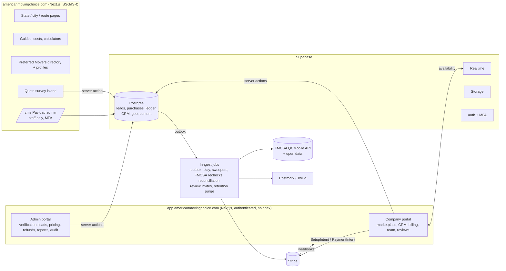

# Recommended Stack and Architecture

**Status:** Recommendation for approval. Prices are approximate list prices as of this writing; **verify them on each vendor's pricing page** before budgeting.
**Last updated:** 2026-10-27

---

## 1. Summary

| Concern | Recommendation | Why | Main tradeoff / alternative |
|---|---|---|---|
| Web app (public + portals) | **Next.js (App Router, TypeScript)** on **Vercel** | Server rendering and static/incremental generation give crawlable, fast public pages. One language end to end. First-class Vercel previews per PR. The Vercel connector is already available in this workspace. | Framework churn. Alternatives: React Router v7/Remix, or Astro for the public site plus a separate React app. |
| Transactional database | **PostgreSQL 16 (Supabase-managed)** | Row locks, partial unique indexes and transactions make the inventory and ledger guarantees enforceable in the database (already proven by `db/test`). RLS adds a second layer of company isolation. | Supabase coupling for Auth/Realtime/Storage. Business logic stays in portable SQL + TypeScript. Alternative: Neon + Auth.js/Clerk + Ably + S3. |
| Auth | **Supabase Auth** (email + passwordless, TOTP MFA; MFA required for owner, billing and admin roles; SSO for internal admins when available on plan) | Integrated with RLS (`auth.uid()`). | Clerk has richer org features at higher cost. |
| Real-time availability | **Supabase Realtime** broadcast channels (lead ID, status and buyer count only; never PII) | Already in the stack. The server stays authoritative. | Ably/Pusher. |
| CMS | **Payload CMS 3** inside the Next.js app, Postgres adapter, separate schema | Drafts, autosave, version history, rollback, scheduled publishing, field-level access control, live preview. MIT-licensed, so no seat fees. Editorial review workflow via status + role access. | We maintain it. Alternative: Sanity (hosted, excellent editor, per-seat pricing). |
| Payments | **Stripe**: SetupIntents for saved cards with explicit future-charge authorization, off-session PaymentIntents for purchases, Radar, optional ACH Direct Debit for **prepaid** top-ups, optional Stripe Tax | Industry standard. No Connect needed because we never pay out to movers. | Internal ledger is the system of record for credits (Stripe customer balance applies only to invoices). |
| Background jobs | **Transactional outbox** table + **Inngest** durable functions (retries, schedules, idempotency) | The outbox makes "commit then notify" reliable. Inngest runs well with serverless Vercel functions. | Trigger.dev, or pg-boss on a small always-on worker. |
| Email / SMS | **Postmark** (separate transactional and broadcast streams); **Twilio** for SMS (A2P 10DLC registration required) and Lookup (phone line type) | Deliverability, webhooks, compliance features. | Resend / SES; Telnyx / Vonage. |
| Spam and abuse | **Cloudflare Turnstile**, rate limits (Upstash Redis or Vercel Firewall rules), honeypots, risk scoring | Invisible to most users. | hCaptcha. |
| Media | Images in Supabase Storage served through Next.js image optimization (AVIF/WebP, responsive sizes); **Mux** for the video module (HLS, posters, captions) | Efficient delivery; captions and transcripts supported. | Cloudflare Images + Stream. |
| Analytics | **GA4** (consent mode) + **Search Console** + **Bing Webmaster Tools** for acquisition; **PostHog** for product funnels; server-side business metrics from Postgres | No contact PII in any analytics payload (enforced by a typed event schema and payload scrubbing). | Plausible/Fathom for simpler web analytics. |
| Observability | **Sentry** (errors + performance), Vercel log drains, uptime checks, Postgres audit log | — | Datadog (costly). |
| Testing | Vitest (unit), Postgres integration tests (existing), Playwright E2E + axe-core accessibility, Lighthouse CI performance budgets, Stripe test mode + Stripe CLI webhook replay | — | — |

## 2. System shape

**Two deployable apps in one monorepo** (`apps/web`, `apps/app`, plus `packages/core`, `packages/db`, `packages/ui`):
- `apps/web` serves public, crawlable pages and the CMS admin. It ships minimal client JavaScript, and the quote survey is the main interactive island.
- `apps/app` serves the company and admin portals on a separate subdomain. Every route requires authentication and sends `X-Robots-Tag: noindex`. Admin routes require the admin role, MFA, and optionally an IP allow-list.
- Shared domain logic lives in `packages/core` (already started), and SQL lives in `packages/db` (currently `db/`).

## 3. Environments

| Environment | Database | Payments | Purpose |
|---|---|---|---|
| Local | Docker Postgres / Supabase CLI | Stripe test mode + CLI | Development, tests |
| Preview (per PR) | Supabase branch | Stripe test mode | Review and E2E against real infrastructure |
| Staging | Separate Supabase project | Stripe test mode | Release candidates, restore drills, reconciliation demos |
| Production | Separate Supabase project (PITR enabled) | Stripe live | Restricted access, change-managed migrations |

Secrets are kept only in Vercel/Supabase/Inngest environment configuration (Stripe restricted keys, webhook signing secrets, FMCSA WebKey, Twilio/Postmark tokens). Nothing secret is sent to the browser. Keys are rotated on staff changes.

## 4. Security

- **Authorization on the server for every action.** Each request resolves the user's company membership and role (owner, manager, agent, billing) and checks a permission matrix (see `docs/architecture/data-model.md` §2). RLS policies mirror company isolation as defence in depth (proven for CRM notes in `db/test`). Service-role database access exists only in server code paths that need it (webhooks, jobs, admin) and is audited.
- **Private data minimization:** consumer contact fields are readable only through purchase-checked functions (`lead_contact_for_company`). Contact values are hashed for deduplication. Every view and export of contact data is logged.
- **Audit log:** append-only table (no UPDATE/DELETE grants) of who did what, before and after, from where. It covers pricing, refunds, verification decisions, review moderation, role changes, exports and settings.
- **Abuse controls:** rate limits on survey submission, login, purchase and export endpoints; Turnstile; anomaly alerts (purchase spikes, export volume).
- **Web hardening:** strict CSP, HSTS, secure cookies, CSRF protection on mutations, dependency scanning (Dependabot/Renovate + `pnpm audit` in CI), and secret scanning.
- **Backups and restore:** Supabase daily backups + point-in-time recovery in production. Target RPO ≤ 15 minutes and RTO ≤ 4 hours (to confirm). Restore drill into staging **before launch and quarterly**, with a written runbook and evidence.
- **Retention (counsel):** proposed defaults are leads and contact data for 24 months after last activity, then anonymized; consent records and disclosure logs kept longer (e.g. at least 5 years to cover the TCPA limitation period); financial records for 7 years. Deletion/access requests are handled through an admin workflow that respects legal holds.
- **Search exposure:** portals require authentication and send `noindex`. Previews never contain PII. Public profiles show only company data the company is authorized to publish.

## 5. Performance

- Targets at the 75th percentile once field data exists: **LCP ≤ 2.5 s, INP ≤ 200 ms, CLS ≤ 0.1**.
- Before launch we report **lab** results (Lighthouse CI on representative templates with mobile throttling, WebPageTest). After launch we report **field** results separately (CrUX/Search Console, Vercel Speed Insights or the `web-vitals` library feeding PostHog). Lab numbers are never presented as field numbers.
- Budgets per public template: ≤ 100 KB compressed JavaScript on content pages (the survey island loads on interaction or idle), hero image ≤ 120 KB AVIF at mobile size with `fetchpriority="high"`, self-hosted subset fonts with `font-display: swap` and metric overrides to avoid CLS, video posters only until the user plays.
- Portal: optimistic UI only where the server stays authoritative. Purchase buttons show a pending state and never fake success.

## 6. Measurement plan

Typed events (no contact PII), sent from the server where possible:

| Area | Metrics |
|---|---|
| Survey | survey_started, step_viewed/step_completed (step id), validation_error (field, code), survey_abandoned (derived), lead_submitted |
| Quality | lead_qualified, lead_rejected (reason), lead_needs_review, duplicate_joined |
| Matching | lead_listed (eligible company count), lead_unmatched |
| Marketplace | purchase_attempted, purchase_succeeded (lead type, position), purchase_failed (reason), time_to_first_purchase, sell-through (buyers ÷ limit), exclusive vs shared sales |
| Finance | gross charges, sharing credits, quality refunds, cash refunds, net revenue, payment fees, **contribution margin by source category** |
| Companies | application → approved → first purchase (activation), repeat purchase rate, CRM usage, churn |
| SEO | organic landing-page sessions, survey starts and leads per landing page, Search Console impressions/clicks/positions by page family |
| AI search | referral sessions from known AI hosts (e.g. chatgpt.com, perplexity.ai, gemini.google.com, claude.ai, copilot.microsoft.com) and their UTM tags, plus a documented monthly query sample (platform, date, location, cited URL, limitations) |

Attribution is stored server-side on each lead: first and last touch landing page, referrer, UTM parameters, and ad click IDs (visible to admin only). Each attribution record carries an **evidence level**: *observed* (click ID or UTM present), *referrer-inferred*, or *unknown*. The marketplace shows only the coarse source category.

## 7. Estimated operating costs (launch scale, approximate)

| Item | Approx. monthly | Notes |
|---|---|---|
| Vercel Pro | $20 per member + usage | Image optimization and function usage grow with traffic |
| Supabase Pro (production) | $25 + compute add-on (~$10–$110) | PITR add-on adds roughly $100+/month; confirm |
| Supabase (staging) | $25+ | Can be paused when idle |
| Payload CMS | $0 license | Runs inside the app |
| Inngest | Free tier at launch; paid tier as volume grows | Confirm the current tier limits |
| Postmark | ~$15+ | Volume-based |
| Twilio SMS + Lookup | Usage-based | Per-message, carrier and 10DLC registration fees; Lookup per request |
| Sentry | ~$26+ | Team plan |
| Mux video | Usage-based, low at launch | A few short videos |
| Turnstile | $0 | — |
| Email validation, consent certificates (e.g. TrustedForm) | Usage/quote-based | Optional; decide in Phase 4 |
| Semrush | Existing subscription | Connected in this workspace |
| Stripe | 2.9% + $0.30 per card charge; ACH 0.8% capped at $5 | Verified in the compliance research; confirm the account's actual pricing |

**Rough fixed platform cost:** about **$250–$600/month** before usage-based messaging, payment fees, paid data sources, people and advertising. This is a planning range, not a quote.
